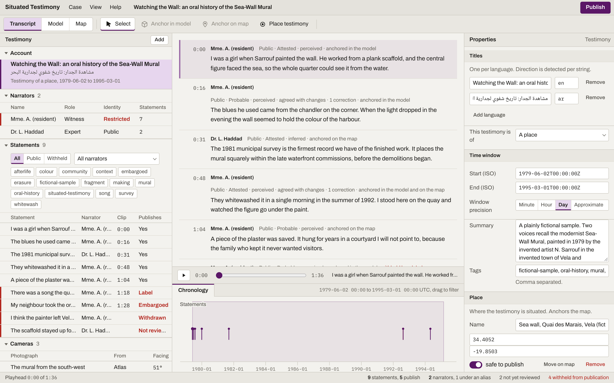
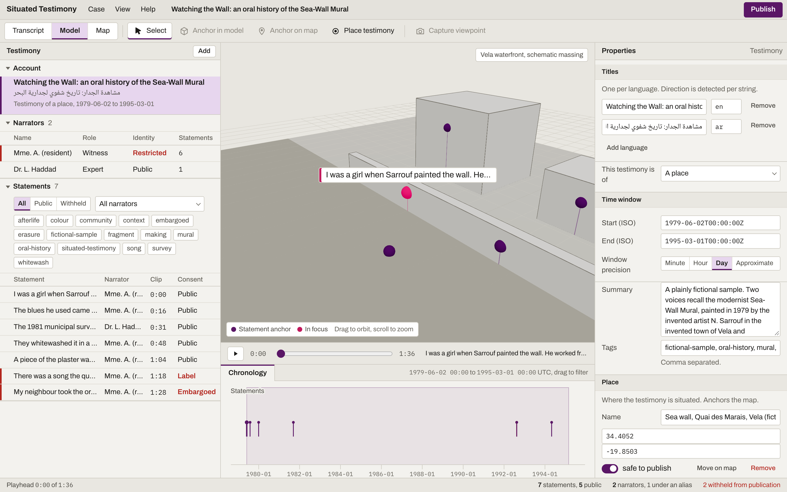
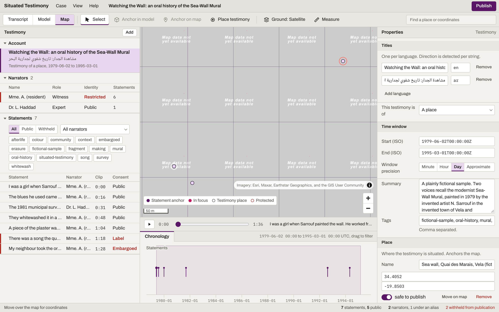
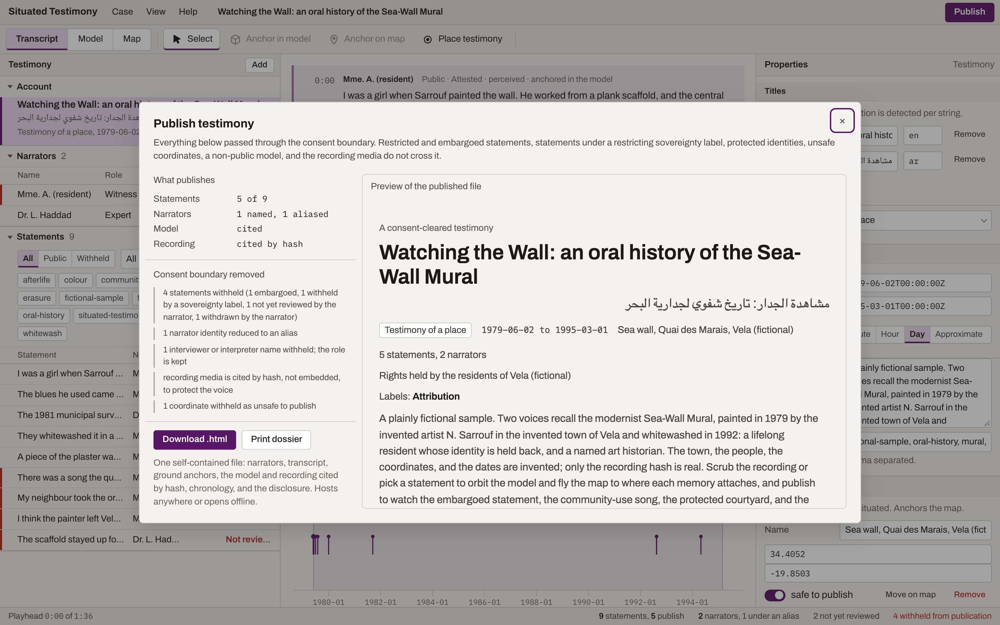
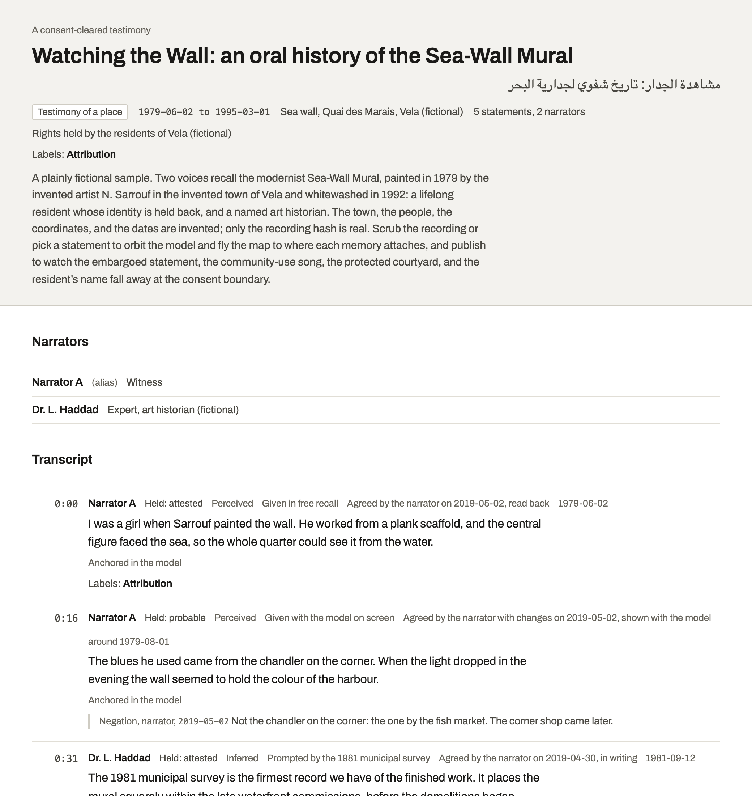

# Situated Testimony

**Attach an oral account to the place, the model, and the moment it concerns, under the narrator's own consent.**

Situated Testimony is a client-side, local-first workbench for testimony that is
*situated*: each statement in a recorded account is tied to where it happened (on
a map and on a 3D model of the site) and when (on a recording and a timeline), and
the whole is governed by the narrators' consent and the rights of the communities
involved. The output is a consent-cleared, self-contained static artifact.

It is the third instrument in the **Parallax** suite. Everything runs in your
browser and no file is uploaded: the testimony, its media, and its locations stay
on your machine. The map retrieves a basemap (satellite imagery by default) and
the place search calls a geocoder, so those services see the area you are viewing
and the names you search, never the testimony itself. An offline grid basemap is
one click away when even that is unwanted.



---

## Contents

- [What it is](#what-it-is)
- [How it works](#how-it-works)
- [Install and run](#install-and-run)
- [The interface](#the-interface)
- [The testimony](#the-testimony)
- [Narrators](#narrators)
- [Statements](#statements)
  - [What a statement records](#what-a-statement-records)
  - [Anchoring a statement](#anchoring-a-statement)
  - [Consent and sovereignty on a statement](#consent-and-sovereignty-on-a-statement)
- [The witness as author](#the-witness-as-author)
  - [How a statement was given](#how-a-statement-was-given)
  - [The correction log](#the-correction-log)
  - [Narrator review](#narrator-review)
  - [The interview](#the-interview)
- [The recording transport](#the-recording-transport)
- [The three views](#the-three-views)
- [The map: basemap, search, and measure](#the-map-basemap-search-and-measure)
- [Consent, sovereignty, and release](#consent-sovereignty-and-release)
- [Publishing](#publishing)
- [Saving and sharing projects](#saving-and-sharing-projects)
- [Starting over: New and Reset](#starting-over-new-and-reset)
- [A worked example](#a-worked-example-end-to-end)
- [Keyboard and accessibility](#keyboard-and-accessibility)
- [Limits and caveats](#limits-and-caveats)
- [Privacy and data handling](#privacy-and-data-handling)
- [Troubleshooting](#troubleshooting)

---

## What it is

The question Situated Testimony answers is: **what does this witness say, where
does each thing they describe sit in the place, and when, and what may be made
public?** It is the situated-testimony method (the practice of recording an
account against a reconstructed space) turned into a working instrument, with
consent and community rights held as first-class parts of the record rather than
an afterthought.

A statement here is not a loose quotation. It is anchored: to a point on the map,
to a point on a 3D massing of the site, to a clip of the recording, and to a
moment on the timeline. Pick a statement and the model orbits to it, the map flies
to it, and the recording cues to its clip.

What it is **not**:

- Not a transcription tool or a subtitling editor. It situates statements; it does
  not produce the recording.
- Not a cloud tool. The recording and the model stay on your machine; nothing is
  uploaded.
- Not a sovereignty-management system of record. It carries a deliberately lean
  rights layer sufficient to govern what publishes, not a full CARE or TK Label
  registry.

---

## How it works

A testimony project is built from a few kinds of record:

- **The testimony** is the account as a whole: its titles, what it is of (a place,
  an event, an object), the narrators, a time window, a sovereignty block, an
  optional place that anchors the map, and optional **recording** and **model**
  attachments.
- **Narrators** are the voices: each has a name, a role (witness, expert), and an
  **identity consent** that decides whether the name may ever be published.
- **Statements** are the situated units of testimony: text in one or more
  languages, attributed to a narrator, with a certainty, a consent level, a
  sovereignty block, an optional clip of the recording, a time it refers to, and
  an anchor (a map point, a model point, or both).

Everything you publish or export passes through one **consent boundary**. It drops
statements that are not public or that carry a restricting sovereignty label,
reduces a protected narrator to an alias, withholds the model and unsafe
coordinates, and cites the recording by hash rather than embedding the voice.

Your records and media live in your browser's IndexedDB; the recording and model
bytes are held there and never uploaded.

---

## Install and run

Situated Testimony is a static client-side app built with Vite.

```bash
cd tools/situated-testimony
npm install        # first time only
npm run dev        # opens a local dev server (Vite prints the URL)
```

For a production bundle:

```bash
npm run build      # outputs to dist/
npm run preview    # serves the built bundle locally
```

On first launch the app loads a **fictional sample testimony** (two invented
voices recalling a mural) so there is something to drive immediately. Your work
saves to the browser automatically.

---

## The interface

Situated Testimony is laid out like working software.

- The **title bar** carries the menus, the testimony's title, and **Publish**, the
  one primary action. **Case** holds new, open, save, and reset to the sample;
  **View** holds the stage view and the appearance; **Help** holds About and this
  guide.
- The **tool bar** holds the stage switch (**Transcript**, **Model**, **Map**)
  and the tools themselves: **Select**; **Anchor in model** and **Anchor on map**
  (each needs a statement selected, switches to its view, and waits for a click);
  and **Place testimony** (a click on the map sets the testimony's place). The
  current view adds its own tools: in the Model view, **Capture viewpoint**; in the
  Map view, the **Ground** control, **Measure**, and the place search.
- The **Testimony** pane on the left is an outline of the account: the testimony
  itself, then the narrators and the statements as compact tables. Each group
  folds away, and **Add** in the pane's header adds a narrator, a statement, or
  statements from a transcript file.
- The **stage** in the centre shows the current view.
- The **Properties** pane on the right edits whatever is selected, as a grid of
  labelled fields grouped under plain headings.
- The **dock** along the bottom carries the recording transport above the
  **Chronology**.
- The **status bar** at the foot reports the cursor's coordinates in the Map view
  (and the playhead elsewhere), the counts of statements and narrators, how many
  narrators publish under an alias, and how many statements are withheld from
  publication. Outcomes (saved, imported, reset) appear here too.

**Appearance.** Situated Testimony opens in a light working mode and switches to a
dark one when your system does. View, then Appearance, fixes it to Light or Dark
for this browser; the choice is a viewer's preference and is never saved in the
project. The 3D scene, the map's marks, and the chronology follow the choice. On a
narrow screen the panes stack, with the stage first.

- Click the **testimony** at the top of the outline to edit it.
- Click a **narrator** or a **statement** row to select it; the Properties pane
  switches to its editor and the views follow the selection.
- Each narrator row gives the name, role, whose identity may be known (in words),
  and how many statements the narrator gives. Each statement row gives the
  opening words, the narrator, the clip time, and its consent. A statement that is
  restricted, embargoed, or held back by a sovereignty label (read **Label**)
  shows in red with a red rule down the row's edge; so does a narrator whose
  identity is protected.
- Above the statements, filters narrow the list: **All**, **Public**, or
  **Withheld**; a narrator; and one or more tags.

Rail rows are keyboard-navigable: tab, then Enter or Space.

---

## The testimony

Selecting the testimony card opens its editor:

- **Titles.** One per language, direction detected per string.
- **This testimony is of.** A place, an event, or an object.
- **Time window** with a precision.
- **Summary** and **tags.**
- **Place.** A name, coordinates, a **safe to publish** toggle, and **Move on
  map**: the location the map view orients to.
- **Recording** and **model.** Attach the audio (or video) recording and the 3D
  model of the site; these power the transport and the Model view. The model can
  be a local glTF/glb file (hashed and held in your browser) or a URL to one the
  host serves cross-origin, fetched to display with only the URL stored. With
  neither, a neutral procedural massing stands in.

The testimony also carries a sovereignty block (a rights holder and any labels)
that applies to the account as a whole.

---

## Narrators

Choose **Add**, then **Narrator**. A narrator has:

- **Name.** Held back in publication when identity consent is restricted.
- **Role.** Witness, expert, and so on.
- **Who may know this narrator.** **Public** (the name may publish) or **restricted** (the
  name is held back; in anything published the narrator becomes a stable alias,
  Narrator A, Narrator B).

A narrator's row shows a count of their statements; the narrator filter above the
statements focuses the list on that voice. A narrator with no surviving public statement is
dropped from the published artifact entirely.

---

## Statements

Choose **Add**, then **Statement**, to add one, attributed to the current narrator.

**Add**, then **Statements from a transcript**, reads an existing transcript instead of retyping it: an
SRT or VTT subtitle file becomes statements with their clip times already set,
and a plain-text file becomes one statement per paragraph. Imported statements
arrive public, marked probable, attributed to the testimony's first narrator, and
unanchored; reattributing, anchoring, and consent remain your work.

### What a statement records

- **Text.** In one or more languages, direction detected per string.
- **Narrator.** Which voice this statement belongs to.
- **How it was given**, **what it rests on**, and **how firmly it is held** (see
  [The witness as author](#the-witness-as-author)).
- **Clip.** A start and end time in the recording; selecting the statement cues
  the recording here.
- **Refers to.** The moment the statement is about, which places it on the
  chronology.
- **Anchor.** A point on the map, a point on the 3D model, or both (see below).
- **Consent** and **sovereignty** (see below).

The transcript reads out, in words, each statement's consent, its certainty, and
its anchors (anchored in the model, on the map, or both), and says "withheld by a
label" in red when a sovereignty label applies. The statement's row in the outline
gives its consent, or **Label** in red for a label that withholds it.

### Anchoring a statement

A statement becomes situated when you anchor it:

- **On the map**: place a geographic point for where the statement's content sits.
- **On the model**: in the Model view, place a point on the 3D massing of the
  site, so the statement attaches to a wall, a corner, a position in the space.

An anchored statement is what lets the model orbit and the map fly to it when you
pick it.

A statement can also carry a **3D viewpoint**: frame the shot in the Model view
(orbit and zoom until the framing says what the statement says), then press
**Capture viewpoint** in the statement editor or in the tool bar. From then on, selecting the
statement flies the camera to that saved pose before releasing it to your hand.
Recapture replaces the pose; Clear removes it.

### Consent and sovereignty on a statement

Each statement carries:

- A **consent level**: public, restricted, or embargoed, chosen in the editor
  under "Who may see this statement", each level with its meaning beside it.
- A **sovereignty** block: a **rights holder** and optional **labels**. A label
  marked as restricting (for example a community-use label, "shared for the
  community, not for open publication") withholds the statement from anything
  published, whatever its consent flag says. This is how a community's decision
  about a song or a name is enforced by the tool, not left to the editor's memory.

---

## The witness as author

A testimony is the narrator's account, not the investigator's. Situated
Testimony records the narrator's part in it: how each statement was given, how it
was revised, and whether the narrator agreed to it before it was published. In
Forensic Architecture's practice the witness directs the model and the
distortions are kept as evidence (Weizman 2017, 44 to 47); a model can also
prompt memory and wear away the witness's own standing (Kinstler 2022, 328 to
330). Recording how each statement was given is what protects the testimony
against the charge that the model put it there.

### How a statement was given

In the statement editor, under **How it was given**:

- **Given**: **Free recall** (before the model or any image was shown), **With
  the model** (the 3D model was on screen), **Prompted** (by a document or
  image, which you name), or **Not recorded**.
- When a statement is given **with the model**, the camera view on screen is
  logged, with the time. A statement added while the Model view is open is
  recorded this way automatically; **Log the view on screen** records it by hand.
  The logged view stays in the project and is never published. It is separate
  from the 3D viewpoint you save for the selection to fly to.
- **Rests on**: **Perceived** (what the narrator saw or heard), **Inferred**
  (what they worked out), or **Heard from others**. Observation and explanation
  are different claims (Schuppli 2014, 62).
- **Held**: how firmly the narrator holds the statement, attested, probable, or
  uncertain. This is not a judgement of reliability: a gap or hesitation in a
  traumatic memory is not unreliability, and belongs in the correction log.

### The correction log

Recall works by comparison and negation, "it was not there", "not like that"
(Stuckey 2022, 6 to 7). The **Correction log** keeps each revision as the narrator
or interviewer gives it: a **correction**, a **negation**, an **addition**, or a
**withdrawal**, with who made it and when.

The log is append-only. An entry can be marked **superseded**, with a reason, but
it is never deleted; superseded entries read struck through. The log publishes
beside the statement it revises, under that statement's own consent: the history
of the account is part of the evidence.

### Narrator review

Before anything is published, the narrator reviews each statement: **Not yet
reviewed**, **Agreed**, **Agreed with changes** (the changes are in the correction
log), or **Withdrawn**, with the date and how the review was done (read back,
shown with the model, in writing). Survivors who corrected the model were its
co-authors (Smith and Watson 2023, 49 to 50).

Only an agreed statement crosses the consent boundary. A statement not yet
reviewed is held back, and a withdrawn one never publishes; the disclosure counts
both. The statements table's **Publishes** column and the status bar say how many
are not yet reviewed.

Projects made before this release carry no review, so every statement in them
reads as not yet reviewed and is held back until it is marked agreed.

### The interview

The listener shapes the speech (Abu Hamdan 2014, 73). In the testimony editor,
under **Interview**, record the **interviewer**, the **interpreter**, and the
**languages** spoken and translated. Their roles always publish; a name publishes
only when it is marked **Named**, and otherwise the published file says the role
was filled without naming the person. The **setting** (where and how the
interview took place) can locate a witness, so it stays in the project and is
never published.

---

## The recording transport

The dock beneath the stage is the transport: a play control, a playhead, the total
duration, and the text of the statement currently under the playhead.

- Press play to scrub the recording; the current statement is shown.
- **Selecting a statement cues the recording to its clip.** This is the
  synchronized move: the transcript, the recording, the model, and the map are one
  instrument, and picking a statement moves all of them together.

The recording itself is never embedded in the published artifact; it is cited by
its hash, to protect the voice.

---

## The three views

The stage switch in the tool bar (**Transcript**, **Model**, **Map**, also in the
View menu) changes the stage:

- **Transcript** is the account read in order, each statement timecoded to its
  clip, with its narrator and, in words, its consent, certainty, and anchors. This is the
  default reading.
- **Model** is the 3D massing of the site. Drag to orbit, scroll to zoom; the
  statement anchors sit in the space, and selecting a statement orbits to it. The
  scene is a schematic massing, not a photoreal reconstruction: enough to situate a
  memory against a wall or a corner.
- **Map** places the statement anchors and the testimony place on a retrievable
  basemap, satellite imagery by default. Selecting a statement flies to its
  anchor. The Ground control, the place search, and the measure tool are covered
  in [the next section](#the-map-basemap-search-and-measure).

The Model and Map are drawn live in the browser; on a very first switch in some
environments they paint once you interact (orbit, or pan), which is a rendering
quirk of a backgrounded canvas, not a fault in the data.





---

## The map: basemap, search, and measure

The Map view carries its own small toolkit, added in 1.3.0.

**Basemap.** The **Ground** control in the tool bar chooses the ground: **Satellite** (Esri
World Imagery, tokenless, the default), **Streets** (OpenStreetMap), **Topo**
(Esri topographic with hillshade), **Grid** (the offline graticule; nothing is
fetched), or **File** (a local `.pmtiles` basemap; nothing is fetched). A
**Place labels** toggle overlays place names on the online grounds; the offline Grid
and File grounds ignore it, so they stay fetch-free.

**Dated imagery.** With Satellite active, the **Imagery date** choice switches from the
live mosaic to a dated release of the Esri World Imagery Wayback archive. A
testimony about 1992 can be read against imagery from a chosen date rather than
today's, which is often the whole point.

**Search.** The search box at the right of the tool bar takes a place name or a bare coordinate. A typed
`lat, lng` resolves locally with no network call; a place name is sent to the
Nominatim (OpenStreetMap) geocoder, and picking a result flies the map there.

**Measure.** The Measure tool starts a path: click to add points, and the card
over the map gives the running distance in metres; a third point closes the figure
and adds its area. Undo, Clear, and Done are on the card. The map also carries a
key and a scale bar. Measurements are a
reading aid; they are not saved to the project.

**What retrieval discloses.** Tile requests disclose the tile coordinates of the
area you are viewing to the tile host (Esri or OpenStreetMap); a place search
discloses the search text to the geocoder. No statement, narrator, media, or
project data is ever part of these requests. Grid and File fetch nothing at all.

---

## Consent, sovereignty, and release

Three controls govern what may publish, all enforced by the boundary rather than
by discipline:

- A statement's **consent level** (public, restricted, embargoed).
- A statement's **sovereignty labels** (a restricting label withholds it).
- A narrator's **identity consent** (restricted names are aliased).
- A point's **safe to publish** flag, and the model's own consent.

When you publish or export, one boundary function (`publicClone`) runs over the
whole testimony and:

- drops statements that are not public, and drops public statements that carry a
  restricting sovereignty label;
- holds back statements the narrator has not yet reviewed, and drops statements
  the narrator withdrew;
- publishes how each statement was given (without the logged camera view), what
  it rests on, its review, and its correction log;
- names the interviewer and interpreter only with consent, and never publishes
  the interview's setting;
- reduces a non-public narrator to a stable alias, and drops a narrator left with
  no surviving statement;
- withholds the 3D model unless its consent is public, and withholds the anchors
  that depended on it;
- withholds coordinates marked not safe to publish;
- cites the recording by its hash and never embeds the audio, so the voice itself
  is not released;
- omits private notes and internal keys.

The result is that a withheld name, an embargoed statement, a community-use song,
and a protected location all fall away at the boundary, together.

---

## Publishing

**Publish** in the title bar runs the testimony through the consent boundary and opens
a dialog showing what publishes (statements and narrators surviving out of the
totals), a plain-language list of everything withheld (statements dropped by
consent or by label, the narrator aliased, the recording cited by hash, the
coordinate withheld), and a live preview that is the artifact.



**Download .html** gives you a single self-contained file: the situated
transcript, the map of anchors, the chronology, the narrators as cleared, and the
consent disclosure. It opens offline and hosts anywhere.



---

## Saving and sharing projects

- **Case**, then **Save project file**, saves the whole project as a single
  `.testimony.json` file, media included, so it round-trips exactly.
- **Case**, then **Open project file**, loads a project file back.

---

## Starting over: New and Reset

- **Case**, then **New testimony**, starts an empty testimony (one unnamed
  narrator, no statements). It asks you to confirm; save first to keep the
  current one.
- **Case**, then **Reset to the sample**, replaces the current testimony with the
  fictional sample, after the same confirmation.

---

## A worked example, end to end

1. Attach the **recording** and a **model** of the site to the testimony.
2. Add the **narrators**, setting each one's **identity consent** (hold back the
   names that must be protected).
3. Add **statements** from the transcript, attributing each to its narrator and
   setting its **clip** in the recording.
4. **Anchor** each statement: a point on the map, a point on the model, or both.
5. Mark the consent level of each statement, and apply a **sovereignty label**
   (such as community-use) where a community has asked that material be held back.
6. Scrub the **recording**; confirm that selecting a statement cues its clip and
   moves the model and map.
7. **Publish**, confirm what the consent boundary withheld (the names, the
   embargoed and community-use statements, the recording, the protected place),
   and download the artifact.

---

## Keyboard and accessibility

The rail's narrator and statement rows are reachable by keyboard (tab, then Enter
or Space, with a visible focus ring). The menus open with a click and move with the arrow
keys; Escape closes them. Text direction is detected per string, so right-to-left statements
display correctly. The model and map are pointer-driven (orbit, pan, zoom).

---

## Limits and caveats

- **A schematic model.** The 3D view is a massing of the site to situate
  statements against, not a measured or photoreal reconstruction.
- **You bring the recording and the model.** The tool produces neither; it situates
  what you supply.
- **The basemap is a reading surface.** Retrieved imagery (live or dated) is a
  third party's mosaic, not evidence the tool has verified; treat a date picked
  from the Wayback menu as that archive's release date, not a capture date.
- **A lean rights layer.** The sovereignty block governs what publishes; it is not
  a full sovereignty registry.

---

## Privacy and data handling

Situated Testimony is local-first. Records, the recording, and the model live in
your browser's IndexedDB and are never uploaded. The basemap and the place search
are the two retrievals: tile requests disclose the viewed area's tile coordinates
to the tile host, and a search discloses its text to the geocoder; the Grid and
File basemaps make no requests at all. A model loaded from a URL is fetched from
that host. No testimony data rides on any of these requests. The recording is
never embedded in the published artifact, only cited by hash, so the voice is not
released. The published artifact is a single file you control; nothing is sent
anywhere unless you choose to share it.

---

## Troubleshooting

- **Selecting a statement does not cue the recording.** The statement has no clip;
  set its start and end times in the editor.
- **A statement is not on the chronology.** It has no "refers to" time; add one.
- **The model or map looks blank at first.** Orbit or pan once to force a redraw; a
  backgrounded canvas can defer its first paint.
- **A statement will not publish.** Check its consent level and its sovereignty
  labels; a restricting label withholds even a public statement.
- **A narrator vanished from the artifact.** All of their statements were withheld,
  so the boundary dropped the narrator too.

---

*Situated Testimony is part of the Parallax suite. Founded and directed by Jeff
O'Brien.*
